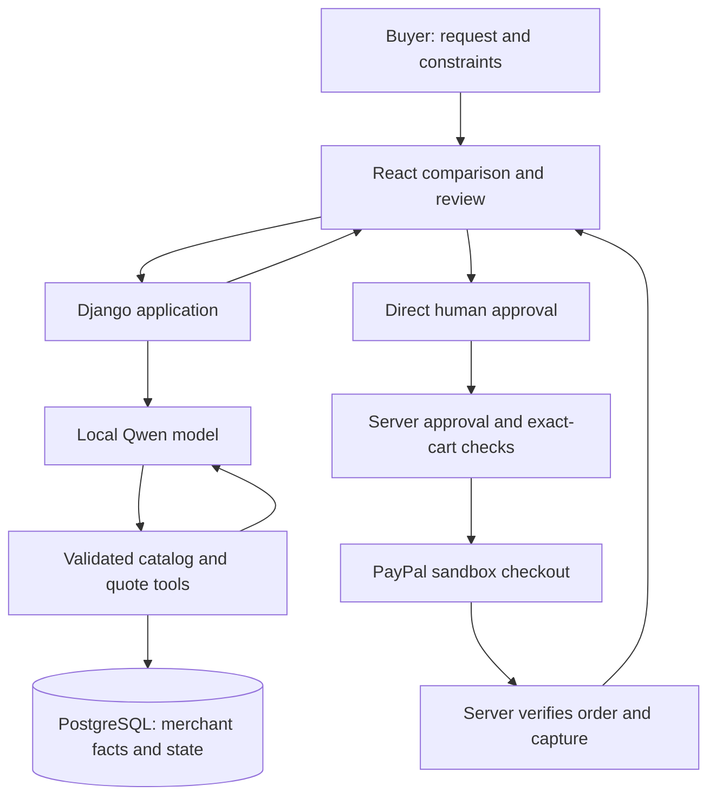

# Architecture and selected stack

Decision date: 16 October 2026; revised after the user asked about Django/PostgreSQL. The current planning stack is Django/PostgreSQL; FastAPI/SQLite is superseded. The active project-completion goal now authorizes implementation of the SpendConsent PRD. Model performance remains an evidence gate. Runtime readiness work is recorded in ai-feasibility.md.

## Stack decision

Detailed design: [components, database, API and payment flows](system-design.md). Delivery sequence: [implementation plan](implementation-plan.md). The diagram in this document is a high-level summary; the detailed design defines quote holds and unresolved-operation behavior.

| Layer | Selected technology | Reason and cost boundary |
| --- | --- | --- |
| Interface | React + TypeScript + Vite; plain CSS and native HTML controls | Clear comparison/review experience using familiar frontend skills. No server rendering, paid UI kit, or additional state library needed. React/Vite are MIT; TypeScript is Apache-2.0. |
| Application server | Python 3.12 + Django 5.2 LTS + Django REST Framework | Familiar framework, models/migrations, sessions/CSRF, validated API and tool inputs. Select compatible supported patch versions in a project-local environment. Django/DRF have permissive BSD licenses; verify dependency licenses before installation. |
| Storage | Existing local PostgreSQL 16 service, dedicated database/role when needed, Django ORM + psycopg | Persistent approvals and attempts with constraints, short transactions, and row locking. No paid hosted database. Do not reuse or alter unrelated databases or server settings. |
| AI | Project-local llama.cpp CPU server + Ollama registry `qwen3:1.7b` Q4_K_M GGUF | Actual model inference with documented tool support and no hosted token bill or expiring trial. llama.cpp is MIT; Qwen3-1.7B is Apache-2.0. Download and runtime have not yet been installed/tested here. |
| Agent workflow | A bounded Python tool loop calling the loopback llama.cpp chat API | One model and three narrow proposal tools. DRF serializers validate arguments/results. No agent framework, vector database, MCP server, or model-controlled HTTP client required. |
| Payments | PayPal Orders v2 REST + current JavaScript SDK v6, sandbox only | Normal buyer approval, server-side create/capture and verified outcome. Current standard-checkout authentication guidance recommends a browser-safe client ID; contradictory token examples remain on that page. Verify the official sample and sandbox readiness before implementation. REST secrets/tokens remain server-only. |
| HTTP and money utilities | Python standard library `urllib.request`, `json`, `decimal`, `hashlib`, `secrets`, `uuid` | Fixed destinations, timeouts, redirect rejection, exact money formatting, approval/session identifiers, and operation IDs. No general payment SDK or extra HTTP package until needed. |
| Verification | Django test runner and transactional database tests; TypeScript/build checks; manual browser journey | Small tests focused on incorrect financial behavior and recovery. Fake responses for routine tests; explicitly approved real sandbox verification separately. |
| Delivery | Local Django server and Vite frontend with same-origin API proxy | No cloud bill, card, domain purchase, or trial expiry. Prepare reproducible local judging instructions. Development servers are not a public production deployment. No Docker requirement. |

Do not pin guessed package versions in this document. At implementation, choose compatible released versions, record dependency licenses, and lock exact versions. This is a concrete stack selection with a feasibility gate for the model, not simultaneous adoption of multiple providers.

## Laptop fit and inference gate

Read-only inspection found: Intel i5-1035G1, 8 logical CPUs, 7.4 GiB total RAM, approximately 2.9 GiB available at inspection, NVIDIA MX250 with 2 GiB VRAM, and approximately 55 GiB free disk. Node 22.14.0 and Python 3.12.3 are installed. Ollama is not on PATH.

[Vite's current guide](https://vite.dev/guide/) lists Node 20.19+ or 22.12+; the installed Node satisfies that published requirement. Template-specific compatibility still needs checking during installation.

The [Ollama model listing](https://ollama.com/library/qwen3:1.7b) reports an approximately 1.4 GB Q4_K_M artifact. That is download size, not runtime RAM usage. The [Qwen model card](https://huggingface.co/Qwen/Qwen3-1.7B) confirms the license and agent/tool-use design; it does not establish reliability on our cases. Do not assume the 2 GiB GPU can accelerate the full workload. A CPU-capable, short-context run is the baseline.

For the first approved feasibility experiment, use a compact schema, retrieved subsets of the catalog, one concurrent inference, and a bounded context/output budget. Start around 4K context and measure rather than assuming a model's maximum context fits RAM. Disable thinking for the initial latency measurement if supported by the selected runtime/model, and do not log hidden reasoning. Record model artifact/digest, runtime version, memory use, cold/warm timing, and every failed tool call.

The PRD's initial gate is 18/20 correct validated task outcomes and warm median request-to-review under 60 seconds. These are targets, not results. Also measure usefulness against manual shopping. If the local model cannot meet them, stop that implementation path and revisit inference or scope. Never replace it silently with prerecorded output or a paid API.

Bind the llama.cpp CPU server to `127.0.0.1:11435`, load the explicit local GGUF, disable its web UI, and use the original Qwen chat template. The current runtime does not have a hosted inference fallback. The original Ollama plan documented `OLLAMA_NO_CLOUD=1`, but no Ollama daemon is adopted. Local inference has no API quota or trial expiry; existing electricity, storage, and network use still apply. No background service or system-wide installer has been started.

Hosted inference was considered. [Gemini pricing](https://ai.google.dev/gemini-api/docs/pricing) advertises limited free model access, but [actual quotas](https://ai.google.dev/gemini-api/docs/rate-limits) and account availability have not been verified here, and free-tier content may be used for product improvement. It is not selected or adopted. No API key, signup, billing change, or private-data transfer occurred.

## System flow

The diagram describes a proposed implementation. There is no AI-to-payment-tool edge. A model can request catalog information and propose a comparison; human-driven application handlers own every payment action.

## Minimum data and API contracts

Persist these responsibilities with simple tables; avoid a generic workflow engine:

- **Catalog/offers:** stable IDs, declared attributes, pack units, price cents, stock, quote version, delivery/tax fixtures, and one configured merchant/payee. Untrusted free text is separate from authoritative numeric fields.
- **Purchase requests:** session, original request, user-confirmed constraints, and request version.
- **Review snapshots:** immutable canonical cart, full charges, material terms, destination reference, quote/version/expiry, and digest. The server builds these from merchant records, not browser totals.
- **Approvals:** associated snapshot/session, validity, status, and the payment attempt that consumed the approval. The model never receives an approval credential.
- **Payment attempts:** snapshot/approval linkage, operation-specific idempotency IDs, PayPal order/capture IDs, status, and sanitized error code. Unique constraints and conditional updates protect one intended execution.
- **Decision events:** short allowlisted events and reason codes. This is an application history, not an independent tamper-proof audit service.

The model-facing tool contract exposes only `search_catalog`, `get_offer`, and `compare_quotes`. Its output is checked against allowlisted IDs and schemas. Initial loop ceiling: six tool steps and an overall timeout; invalid arguments cause a bounded correction or visible failure, never an unsafe fallback.

Application handlers accept requests, return comparisons/reviews, accept direct approval, create the approved PayPal order, capture an approved existing order, and read status. Browser callers provide opaque local IDs, never trusted amounts or arbitrary PayPal order IDs. The server resolves ownership and the immutable payload. Runtime SDK configuration may expose the browser-safe sandbox client ID without hardcoding/logging its actual value. No endpoint returns an ordinary REST bearer token or client secret. A separate client-token endpoint is deferred unless the verified SDK integration requires it.

Use integer cents for storage/comparison and exact decimal strings for PayPal. Count product packs and individual units separately. Avoid persisted floating-point unit costs; calculate display ratios from exact totals with explicit rounding.

## Payment execution and recovery

Use a single configured sandbox merchant with `CAPTURE` intent and normal human PayPal approval. The SDK source and REST API destinations must be sandbox allowlisted; block Live configuration and cross-host redirects. Request-specific financial payloads come only from approved server snapshots.

Reserve the approval for one attempt transactionally before calling PayPal. Use short Django atomic blocks and row locks for approval reservation; do not hold a transaction or lock open across a network call. On completion, record the outcome with a conditional state update. Repeated requests recover that attempt rather than allocating a new one.

Revalidate quote/cart/stock/terms immediately before create and capture. After order creation, compare PayPal order details to the bound snapshot. If the buyer or merchant changes relevant fields, or approval expires before capture dispatch, do not capture under the old approval. Freeze and honor the held quote when capture is dispatched; later merchant edits affect future quotes. Do not release stock or create a replacement while an operation is uncertain. See system-design.md for the transaction boundaries and state machine. A production external merchant requires its own quote/stock guarantees; the buyer app alone cannot provide them.

[PayPal idempotency documentation](https://developer.paypal.com/api/rest/reference/idempotency/) says support and retention vary by API. Verify the selected Orders operations' exact behavior before implementation. Use different persisted keys per create/capture operation and reuse the same key for retries of that operation. An uncertain request remains pending/unknown while read-only verification resolves it. Do not promise network-wide exactly-once delivery.

Show paid only after the server verifies completed capture, matching amount/currency/payee, and order linkage. On refresh or restart, query the existing order/status. For this local synchronous prototype, use verified read-back and explicit status refresh; do not add a public webhook tunnel. Later asynchronous production updates would require verified webhook handling and an appropriate hosting/security design.

## Local security and privacy

Bind application and model services to `127.0.0.1`. The frontend and API share an origin through the local development proxy; a packaged local demo must preserve that boundary. In development proxy `/api` through Vite; do not enable permissive cross-origin writes. Validate Host/Origin, use a random HttpOnly SameSite session cookie and CSRF protection, and reject approvals from another session. Local operation is not a reason to omit request-boundary checks. This design is not approved for exposure to the public internet.

The private `.env` remains server-only and excluded from version control. No secret goes into `VITE_` variables, source maps, model prompts, logs, screenshots, or exported history. Keep REST tokens in server memory; browser-safe SDK tokens are purpose-specific and still excluded from logs. Redact provider error responses by allowlist; disable raw request/response tracing around authentication and payments.

Use fictional business requests and destination fixtures. Keep local database/diagnostic artifacts out of the public repository. Export only sanitized decision evidence, not raw PayPal buyer data or model transcripts. Add user-controlled local reset later; deleting existing data still requires the lab's approval rules.

## Tradeoffs and sponsor use

React/Vite gives the needed product interface without Next.js server-rendering complexity. Django/PostgreSQL now fits the user's existing experience and the desired persistent approval/payment workflow; the PostgreSQL service is already present. The earlier FastAPI/SQLite choice was reasonable for a minimal one-user proof but is superseded. Keep one Django server, one database, and a short native Python agent loop. Do not add a separate FastAPI service, Redis, Celery, JWT, or a generic workflow engine without a concrete need. See stack-review.md for the comparison.

PayPal is essential. No additional sponsor product is required for the core. Do not add AG Grid merely for a logo: native tables handle three offers. Reconsider a sponsor tool only when it improves an actual requirement and its license, free quota, trial expiry, and judging availability are verified. Channel3 product discovery does not automatically supply checkout authority; PayPal Agentic Commerce services require separate onboarding. No gated API is assumed available from the successful OAuth check.

## Official implementation and license references

- [Django support policy](https://www.djangoproject.com/download/), [transactions](https://docs.djangoproject.com/en/5.2/topics/db/transactions/), and [Django REST Framework compatibility](https://www.django-rest-framework.org/community/3.16-announcement/).
- [Django license](https://github.com/django/django/blob/stable/5.2.x/LICENSE), [DRF license](https://github.com/encode/django-rest-framework/blob/master/LICENSE.md), and [psycopg installation requirements](https://www.psycopg.org/psycopg3/docs/basic/install.html). Check the selected driver's license and installed libpq compatibility before adoption.
- [PostgreSQL locking](https://www.postgresql.org/docs/current/explicit-locking.html) and [license](https://www.postgresql.org/about/licence/).
- [React license](https://github.com/facebook/react/blob/main/LICENSE), [Vite license](https://github.com/vitejs/vite/blob/main/LICENSE), and [TypeScript license](https://github.com/microsoft/TypeScript/blob/main/LICENSE.txt).
- [Ollama tool calling](https://docs.ollama.com/capabilities/tool-calling), [structured outputs](https://docs.ollama.com/capabilities/structured-outputs), [thinking controls](https://docs.ollama.com/capabilities/thinking), and [MIT license](https://github.com/ollama/ollama/blob/main/LICENSE).
- [PayPal SDK v6 setup](https://developer.paypal.com/sdk/js/set-up/), [Orders v2 reference](https://developer.paypal.com/api/orders/v2), and [agentic services access](https://developer.paypal.com/agentic-commerce-services/about/).

## Current implementation status

Only the existing standard-library sandbox OAuth diagnostic exists. Its authentication check passed on 13 October; that does not establish Orders entitlement, SDK token setup, payment success, or AI feasibility. No application packages, model weights, application server, project database, frontend, or payment flow were created during planning. PostgreSQL already runs locally; project credentials, database access, and application readiness remain unverified. The later repository setup is documented in project-setup.md.

## Readiness runtime revision — 16 October 2026

The authorized feasibility experiment uses the official llama.cpp CPU release b11696 (MIT) instead of installing Ollama. Its 17.9 MB standalone archive avoids the current Ollama Linux bundle’s 1.44 GB GPU libraries and any global service installer. It runs the same Qwen3-1.7B Q4_K_M model published by the official Ollama registry. The model license is Apache-2.0. Native function calling and structured final output use the original Qwen chat template and the local OpenAI-compatible HTTP protocol; no hosted model/API key is involved. The tool contract and human financial authority are unchanged. Results and exact provenance are recorded in [AI feasibility](ai-feasibility.md). Older Ollama-specific setup paragraphs above describe the original plan and are superseded for this experiment; no Ollama daemon/cloud account was adopted.
