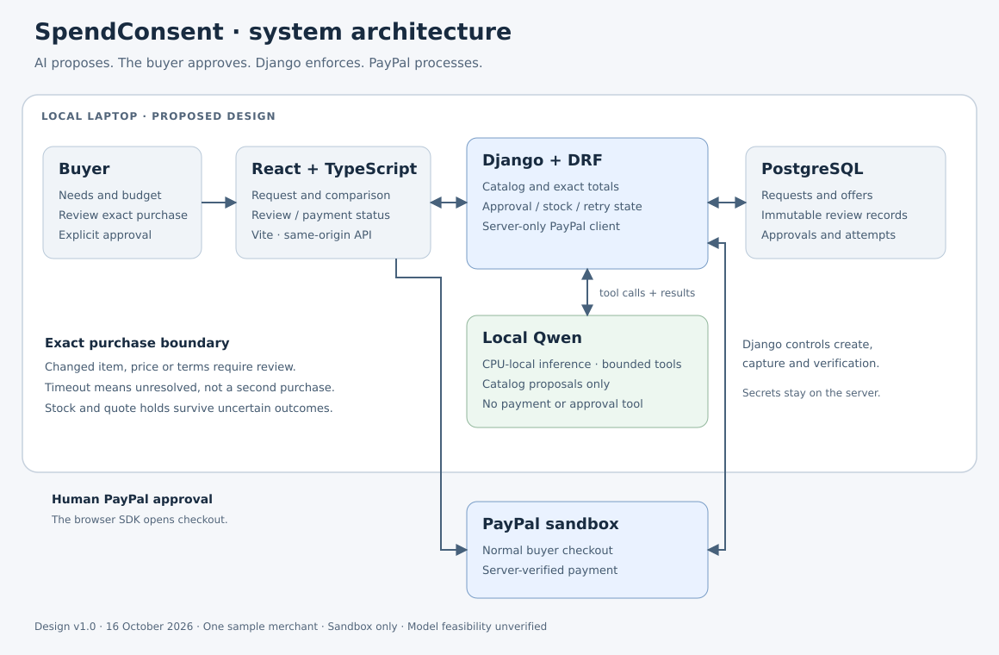
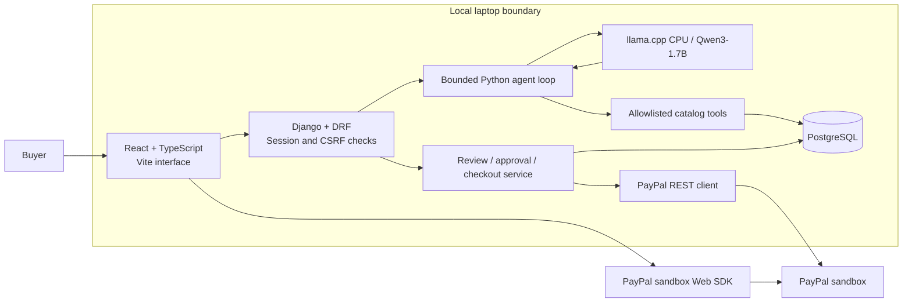
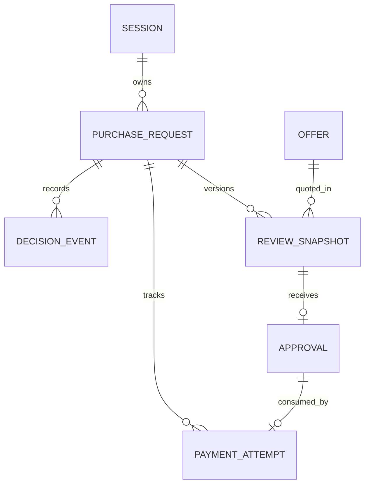

# SpendConsent — system design

Version 1.0 · 16 October 2026 · Architecture deliverable, not an implemented system.

Architecture and implementation planning are authorized. The product remains the working proposal in the [PRD](PRD.md); this request does not authorize installing services, implementing product features, or executing sandbox financial actions. The [stack decision](architecture.md) and [build sequence](implementation-plan.md) accompany this design.

## 1. Design in plain language

A buyer describes the supplies they need. AI searches the sample merchant's catalog and explains suitable pack options. Django calculates the real fixture totals, creates an exact review, and records the buyer's explicit approval. PayPal handles normal sandbox checkout. Django checks the resulting order and payment before showing success.

**AI proposes; the buyer approves; the server enforces; PayPal processes.** The model never receives a payment tool, approval credential, SQL connection, shell, or arbitrary browser/network access.



## 2. Components and deployment

Use one Django application, one PostgreSQL database, and one local inference runtime. They are separate processes, not separate product microservices. The first version serves one local buyer session and one sample merchant with 12–20 SKUs, USD, fixed delivery/tax fixtures, and one-time purchases. Each proposed purchase selects one offer/SKU and an integer number of packs; mixed-SKU baskets are deferred.



| Component | Owns | Cannot do |
| --- | --- | --- |
| React interface | Request form, comparison, review, checkout controls, status/history | Establish authoritative price, approve through model text, hold secret REST credentials, or declare payment success from a callback alone |
| DRF endpoints | Session ownership, CSRF, validated input, safe responses | Trust client-supplied totals, arbitrary provider IDs, or an “approved” flag from AI |
| Agent loop | Interpret requirements, choose catalog tools, request clarification, explain evidence | Write approvals or invoke financial operations |
| Catalog/quote functions | Validate declared specifications, exact pack counts, availability, delivery/tax fixtures and totals | Infer product quality, invent missing facts, or claim market-wide best price |
| Checkout service | Immutable review, approval validity, stock holds, payment state, duplicate protection | Treat an unresolved provider operation as safely failed |
| PayPal client | Fixed sandbox authentication, create/capture after permission, read-back verification | Follow model-supplied URLs, enable Live, or emit raw credentials/responses |
| PostgreSQL | Durable requests, snapshots, approval ownership, payment attempts and short events | Make the distributed PayPal call atomic with a database transaction |

Local default ports are proposed as Vite 5173, Django 8000, PostgreSQL's existing local socket, and the local llama.cpp model server 11435. Bind web/model services to loopback. Proxy `/api` through Vite so browser API calls share the frontend origin; do not enable broad CORS. Existing PostgreSQL is shared infrastructure: later create an isolated project database/role without changing unrelated databases or server configuration.

Use one application process initially. Only one model inference runs at a time; a process-local semaphore is sufficient for this explicit deployment limit. A second inference request gets a visible busy response, not an unbounded queue. No Redis, task broker, background agent, public tunnel, or paid hosting is needed for the demo. Scaling beyond one process requires revisiting model admission and hosting, not pretending the semaphore is distributed.

## 3. Code organization to implement later

```text
backend/
  manage.py
  config/                 Django settings and URL routing
  purchases/
    models.py             Request, offer, review, approval, attempt, event
    serializers.py        API and tool argument validation
    views.py              Thin session-scoped endpoints
    urls.py
    services/
      catalog.py          Filters, pack math, deterministic quotes
      agent.py            Local model calls and bounded tool dispatch
      checkout.py         Review, permission, stock and attempt transitions
    paypal.py             Fixed sandbox HTTP operations and safe parsing
    tests/                Focused permission, concurrency and recovery checks
frontend/
  src/
    App.tsx               One purchasing workspace with explicit UI states
    api.ts                Same-origin fetch and CSRF handling
    components/           Request, comparison, review, payment result
```

This is a proposed layout, not scaffolding created now. Keep one Django domain app. Use normal functions and Django transactions rather than a generic policy engine or workflow framework. Frontend state can remain in React component state; server status always wins after a refresh.

## 4. Data model

Use Django's database-backed session for ownership; no custom user/account table is needed for this local version. Generate an owner UUID server-side and store it in that session; domain records store that UUID, not a foreign key to an expiring session row. Never accept an owner UUID from browser input. Session expiry must not cascade-delete payment evidence. Losing the session prevents ordinary access to prior purchases; no automatic replacement purchase or account-recovery claim is introduced. The SESSION relationship below is logical ownership, not a custom account table or cascading foreign key.

Use UUID public IDs, UTC timestamps, nonnegative integer USD cents, and positive integer quantities. Store only fictional catalog/destination data and sanitized history.



| Entity | Essential fields and rules |
| --- | --- |
| PurchaseRequest | Server-owned owner UUID, client submission UUID, original text, confirmed constraints JSON, version, workflow status, active inference UUID. Unique `(owner_uuid, client_submission_uuid)` makes request-submit retries return the same request. Edits increment the version; late inference results for older versions are discarded. |
| Offer | Stable merchant SKU/variant ID, structured declared attributes, pack units, price cents, stock packs, reserved packs, version, one-time terms. Constraints ensure positive pack size and `0 <= reserved <= stock`. Untrusted description text is separate. |
| ReviewSnapshot | Request FK/version, offer FK/version, immutable normalized payload, SHA-256 digest, quote expiry, creation time. Stores complete pack/individual quantities, line charges, tax, delivery, discount, total, payee and synthetic destination/terms. The browser only selects a server-produced review ID. |
| Approval | One-to-one review FK, approved time, expires time, revoked time; ownership follows the review's request and its owner UUID. Expiry is the earlier of quote expiry and five minutes after approval. The human endpoint owns creation; no model tool can create it. |
| PaymentAttempt | Request FK, one-to-one approval FK, provider order/capture IDs with uniqueness when present, create/capture UUID keys, state, pending operation, frozen quote, stock hold, stop-request flag, sanitized reason, timestamps. One approval can fund only one attempt. |
| DecisionEvent | Request FK, optional attempt FK, allowlisted type/reason, safe comparison fields, timestamp. No raw HTTP body, token, address, complete prompt, or hidden model reasoning. This is ordinary application history, not independently tamper-proof evidence. |

Apply a conditional unique constraint for one active attempt per request across creating, awaiting-buyer, capturing, verifying and unknown states. A paid request cannot start another attempt; a deliberate new purchase needs a new request. This protects request retries, not semantic duplicates across independently created requests.

Offer version changes represent material product/price/terms edits; reserving stock does not increment that version and invalidate its own review. New quotes use `stock - reserved`; capture validation recognizes the attempt's own reservation rather than requiring the same packs to be unreserved again. Finalizing a verified purchase consumes stock and releases its reservation exactly once within a conditional transaction. Keep unresolved holds intact.

Use database constraints for local uniqueness and simple ranges. Cross-record ownership, snapshot consistency and charge sums require service validation plus locked transitions; a JSON field or digest alone does not enforce them. Approved snapshots are never edited in place, including through admin. Changing any material term creates a new review. Tests must cover every write path; do not advertise a cryptographic purchase mandate.

Build the review digest from a fixed schema with normalized integer quantities/cents, fixed currency/IDs, stable timestamp format, sorted JSON keys and UTF-8 encoding. Include all material fields described in the PRD; exclude mutable operational counters such as stock reservations. Recompute server-side; a caller's digest is only a stale-review check, never authorization.

## 5. AI workflow and catalog truth

1. Validate request length and allowed fields. The model proposes structured requirements; show extracted constraints for correction before financial review. Essential ambiguity produces a question.
2. Send only the request, confirmed constraints and compact tool schemas to the local Qwen model server. Catalog descriptions are explicitly untrusted data; render them as escaped text.
3. Permit only `search_catalog`, `get_offer`, and `compare_quotes`. Validate every argument with DRF serializers and scope every result to this catalog/request. No arbitrary SQL, HTTP destination, or function-name dispatch.
4. Code checks dimensions, exact requested individual quantity, whole-pack divisibility, stock, and total budget. Tax/delivery are labeled fixed merchant fixtures. Unknown attributes cannot satisfy a must-have. Choose the lowest full total among eligible retrieved offers, with ties displayed explicitly; do not claim all suppliers were searched.
5. Return at most three candidates with evidence references and deterministic rejection reasons. AI explains them; server-rendered prices/quantities come from tools, never extracted from model prose.
6. Human selection builds a fresh review from current facts. AI output does not become a payment payload.

Initial proposed limits: six tool invocations total, one malformed-output repair, 4K model context, one concurrent run, and a 90-second overall deadline. Bound each network request by the remaining deadline. Compact retrieved data before submission; never silently truncate confirmed constraints. If context, model, or time limits are exceeded, return a visible incomplete/error state. A browser disconnect may not immediately stop inference, so version/run IDs prevent stale completion from overwriting current results.

The llama.cpp runtime remains loopback-only, with no private financial data in model context. The local-model feasibility gate remains unpassed; these limits are defaults to measure. The [llama.cpp server tool-calling interface](https://github.com/ggml-org/llama.cpp/blob/b11696/tools/server/README.md) supports the selected interaction pattern. This supersedes the original Ollama daemon plan; see ai-feasibility.md.

## 6. Approval and purchase sequence

```mermaid
sequenceDiagram
    actor Buyer
    participant UI as React UI
    participant App as Django service
    participant DB as PostgreSQL
    participant PP as PayPal sandbox
    Buyer->>UI: Select offer and inspect exact review
    UI->>App: Approve review ID and expected version
    App->>DB: Validate ownership, current quote, expiry; record approval
    App-->>UI: Approval ID and validity
    Buyer->>UI: Start this sandbox purchase
    UI->>App: Create attempt for approval
    App->>DB: Lock request, approval, offer; reserve stock and attempt; commit
    App->>PP: Create order using stored snapshot and create retry key
    PP-->>App: Provider order ID
    App->>DB: Persist order and awaiting-buyer state
    App-->>UI: Existing attempt ID and order ID
    Buyer->>PP: Approve through normal PayPal checkout
    UI->>App: Capture this existing attempt
    App->>PP: Read order and verify buyer approval and expected fields
    App->>DB: Recheck validity and unchanged quote; freeze capture state; commit
    App->>PP: Capture using stored order and capture retry key
    PP-->>App: Capture response
    App->>PP: Read order for independent completion check
    App->>DB: Persist verified result and finalize stock hold
    App-->>UI: Verified paid or explicit unresolved/mismatch state
```

All actual sandbox financial actions require the lab's explicit action-time approval. In the eventual UI, controls must name the exact action/purchase; a general “continue” prompt or model statement is insufficient. This sequence is a design, not permission to run it now.

Approval uses an authenticated-by-session direct UI request with CSRF checks. It is not proof that any arbitrary computer agent could never click the user's browser. The guarantee is scoped to our model/tool boundary and application paths.

**Quote and stock consistency:** use the lock order request → approval → offer for every competing transition. At create, validate current review version, reserve the required packs, and persist one attempt. At capture, recheck the held quote and current material facts under that same order. Commit `CAPTURING` and freeze the exact merchant quote before HTTP. All sample-merchant mutation paths must honor this freeze: later price edits apply to future quotes, not this committed quote. Never keep database locks open while waiting on PayPal, inference, or a person.

Changes before capture dispatch require review, even if cheaper or still within budget. Once capture may have been dispatched, an edit, cancellation, expiry, or timeout cannot safely undo that operation: resolve its status first. Expiry is evaluated when dispatching a new financial operation, not used to erase an already completed payment. In-flight/unknown stock holds are not released just because five minutes elapsed. This is an explicit single-merchant hold design; a third-party merchant would need compatible quote/reservation guarantees.

## 7. Payment states, retries and cancellation

```mermaid
stateDiagram-v2
    [*] --> CREATING: Valid approval and human start
    CREATING --> AWAITING_BUYER: Provider order persisted
    CREATING --> UNKNOWN: Timeout or crash after possible send
    AWAITING_BUYER --> CAPTURING: Buyer approval and final server gate
    AWAITING_BUYER --> STOPPED: Cancel, expiry or changed terms; no capture in flight
    CAPTURING --> VERIFYING: Capture response received
    CAPTURING --> STOPPED: Definitive no-capture decline
    CAPTURING --> UNKNOWN: Outcome uncertain
    VERIFYING --> PAID: Trusted completed capture matches review
    VERIFYING --> PAYMENT_REVIEW: Captured details mismatch
    VERIFYING --> UNKNOWN: Insufficient trusted evidence
    UNKNOWN --> AWAITING_BUYER: Read-back proves uncaptured existing order
    UNKNOWN --> PAID: Verified matching completed payment
    UNKNOWN --> PAYMENT_REVIEW: Captured mismatch
    UNKNOWN --> STOPPED: Definitive no-capture outcome
```



`UNKNOWN` is a durable state, not a failure synonym. A stale persisted `CREATING`/`CAPTURING` operation after restart is treated as uncertain until resolved. Status reconciliation performs read-only provider requests and never auto-captures or allocates a replacement attempt. Expired or changed approvals still block financial execution if read-back returns an uncaptured order.

Use a different persisted UUID per create and capture operation. Repeated requests return the existing attempt or operation status. A pending duplicate must not dispatch another HTTP call. Where a retry is needed, preserve the same operation key and exact payload, require applicable human permission, and verify the provider's supported retention window first. Never rotate the key to “fix” a timeout.

If order creation times out before an order ID is persisted, do not invent a lookup-by-request-ID API. Keep the request blocked in `UNKNOWN`; investigate the supported same-key recovery path under explicit permission. If the retention window or outcome cannot be established, require manual resolution rather than risking a replacement purchase. The [PayPal idempotency reference](https://developer.paypal.com/api/rest/reference/idempotency/) explicitly makes API support/retention an integration check.

Browser cancellation is a stop request, not proof that PayPal received nothing. If capture is already in flight, show “Checking payment status.” Release stock and allow fresh review only when the service can establish the old attempt cannot be captured through our application and no dispatched capture is unresolved. No automatic refund/cancel-payment API is introduced.

Verify the trusted order ID/linkage, configured payee, currency, approved full amount, returned line/quantity breakdown where available, and completed capture ID/status. Preserve the snapshot-to-payload mapping for fields PayPal does not echo. Missing evidence is not success. A completed mismatching capture enters `PAYMENT_REVIEW`; money may have moved in sandbox, so do not call it safely blocked or automatically refund it. “Paid” confirms payment only, not delivery, quality, or merchant honesty.

## 8. Application API

Every object lookup is scoped to the owning session. All POSTs require Django CSRF and validated input. Unexpected fields, caller-supplied totals, payment destinations and unrelated provider IDs are rejected. Bootstrap the session and a masked CSRF token through `/api/session` without exposing the session key. Because this prototype uses anonymous buyer sessions, explicitly enforce Django CSRF checks on unsafe DRF views: DRF SessionAuthentication alone does not enforce CSRF for anonymous requests. This is a required boundary, not a reason to add a custom login system. See [DRF's session-authentication guidance](https://www.django-rest-framework.org/api-guide/authentication/#sessionauthentication).

| Method and route | Input / result | Authority |
| --- | --- | --- |
| GET `/api/session` | Session/CSRF initialization, sandbox mode, SDK public configuration, capability/readiness flags | No secret REST token; no financial call |
| POST `/api/requests` | Text, confirmed constraints, client submission UUID → request/comparison or clarification | Bounded model + catalog only |
| GET `/api/requests/{id}` | Current version, candidates, status and safe events | Local read |
| POST `/api/requests/{id}/clarify` | Expected version and constraint edits → recomparison | Reject editing while financial operation is unresolved |
| POST `/api/requests/{id}/reviews` | Candidate ID and expected request version → fresh immutable review | Recalculate from current facts |
| POST `/api/reviews/{id}/approve` | Expected review digest/version → exact approval | Direct human UI only |
| POST `/api/approvals/{id}/attempts` | Approval ID → existing/new attempt and provider order ID | Explicit permission; one approval/attempt |
| POST `/api/attempts/{id}/capture` | Existing local attempt ID → verified or unresolved outcome | Explicit permission + buyer approval + final gate |
| POST `/api/attempts/{id}/stop` | Stop request → safe stopped or still pending | No provider financial mutation |
| POST `/api/attempts/{id}/reconcile` | Local attempt ID → refreshed trusted status | Provider reads only; state may be persisted |
| GET `/api/attempts/{id}` | Safe local status/history | Poll only while pending; no hidden capture |

Suggested application errors: `INVALID_REQUEST` (400), `NOT_FOUND` (404 for absent/wrong-session objects), `REVIEW_CHANGED` or `OPERATION_PENDING` (409), `REVIEW_EXPIRED` (410), `MODEL_BUSY` (429), and `MODEL_UNAVAILABLE` / `PAYMENT_STATUS_UNKNOWN` (503 with safe status). Include opaque request/attempt IDs and reason codes; exclude raw provider errors. HTTP failure alone must never tell the UI that a payment did not occur.

No arbitrary public catalog editor or payment override endpoint is part of version one. Controlled fixture-change tests call the same service rules under test, not an unauthenticated demo backdoor.

## 9. UI and integration details

One workspace contains five visible states: request/clarification; offer comparison; exact review/approval; PayPal checkout; verified outcome or recovery. Keep the request and approved total visible. Show individual units and pack count together. A changed review displays the old/new values and requests a fresh decision. Uncertainty gets a “Check payment status” action, not a second Pay button.

Use native controls, keyboard access, labels, focus handling, status announcements, readable contrast and escaped merchant/model text. Render progress from named tool events rather than hidden model reasoning. Disable duplicate controls in the UI, but rely on server constraints for correctness. A refresh reconstructs the current request/attempt from the server.

Use only PayPal one-time wallet checkout and `CAPTURE` intent. No vault, subscription, recurring agreement, authorization/escrow flow, or third-party payouts. Fixed sandbox REST/SDK hosts are allowlisted. Redirects cannot change HTTP destinations. A synthetic fixed delivery destination is server-owned and excluded from prompts/history; reject changed checkout destination or charges before capture.

**SDK correction:** the current [v6 authentication section](https://developer.paypal.com/sdk/js/set-up/) recommends `clientId` for standard checkout, while later examples still use tokens. Plan for the client-ID path, validate against the [official sample](https://github.com/paypal-examples/v6-web-sdk-sample-integration), and defer the earlier token endpoint unless needed. Client ID is browser-safe configuration; keep its actual value out of source/chat/logs. Client secret and ordinary REST tokens stay server-side. No actual credential was read for this review.

## 10. Operational and security limits

- Use existing local services, one isolated project database and one limited model. Keep application/model startup manual and reproducible; no daemon installed by this design.
- Validate session ownership, CSRF, Host/Origin and state on every write. Loopback operation does not replace those checks. Other malicious local software or a compromised operating system is outside this prototype's protection claims.
- Allow only fixed model and PayPal destinations; no merchant text becomes instructions or executable HTML. Test injection fixtures, but do not claim universal resistance.
- Persist only the minimal safe decision events, retry IDs and provider object IDs needed for recovery. No payment bodies, tokens, customer PII, or raw model transcripts in logs. Data deletion/DB reset is a separate explicit action, not an automatic demo cleanup.
- Track per-case result, model/runtime identity, time to comparison/review, active review effort, tool failures and payment verification state. These are evaluation records, not a hosted observability platform.
- In-flight operations survive browser refresh through persisted state; process crashes require explicit reconciliation. There is no scheduled recovery worker or guaranteed unattended recovery in version one.
- PostgreSQL and the model compete for the laptop's memory. Gate the full workflow on measured latency/memory/reliability. No architecture diagram establishes market fit, model capability, or production payment safety.

## 11. Design review and release blockers

Before implementation, confirm the bounded product/build scope. Then follow the [implementation plan](implementation-plan.md). Block the financial journey for any missing approval, state race, mismatched request/payee/amount, unverified provider state, duplicate operation, wrong-session access, or unsupported SDK/idempotency behavior. Do not broaden the scope to hide a failed model/usefulness test.

Primary technical references checked 16 October: [Django transactions](https://docs.djangoproject.com/en/5.2/topics/db/transactions/), [row locking](https://docs.djangoproject.com/en/5.2/ref/models/querysets/#select-for-update), [constraints](https://docs.djangoproject.com/en/5.2/ref/models/constraints/), [CSRF](https://docs.djangoproject.com/en/5.2/ref/csrf/), [PayPal Orders v2 schema](https://developer.paypal.com/api/orders/v2/schema.json), and the SDK/idempotency/Ollama links above. The proposed application tables, endpoints, limits and state machine are our design decisions, not vendor guarantees.
